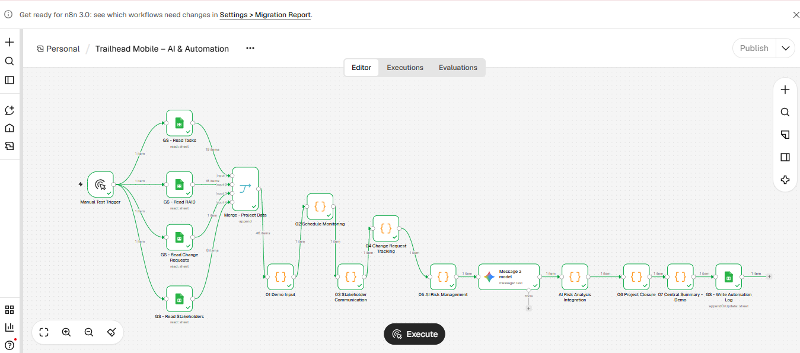
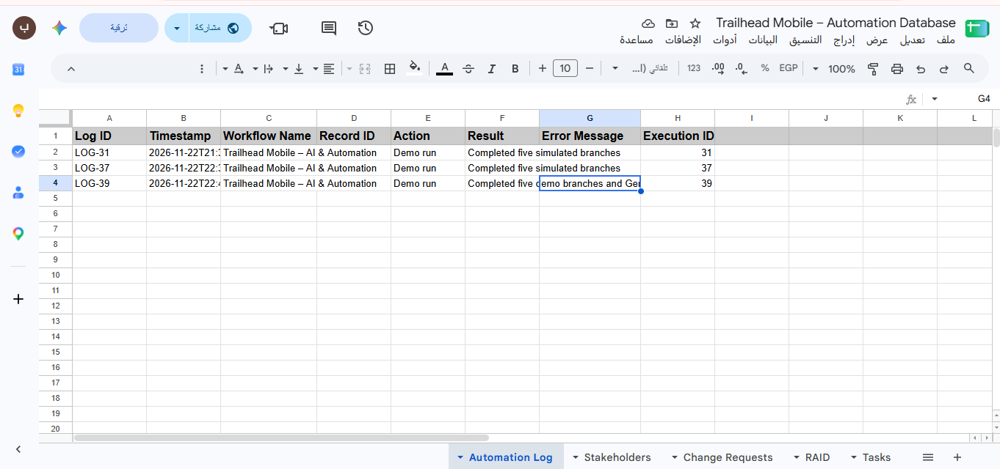

# Trailhead Mobile — AI & Automation

**A safe-demo project management workflow built with n8n, Google Sheets, and Google Gemini.**

This portfolio project extends the Trailhead Mobile project management practicum into an automated reporting and risk-review workflow. It reads structured project records, checks five management areas, uses Gemini to analyze documented open risks, produces a central summary, and writes a run record to Google Sheets.

> **Demo scope:** This is an advisory, manually triggered workflow—not a production release-management system. It does not send stakeholder emails, approve change requests, close the project, or overwrite source project records. The only intended Google Sheets write is an execution entry in **Automation Log**.

## Workflow overview



**Flow:** Manual Test Trigger → Read four Google Sheets tabs → Merge Project Data → Demo Input → Schedule Monitoring → Stakeholder Communication → Change Request Tracking → AI Risk Management → Gemini (`Message a model`) → AI Risk Analysis Integration → Project Closure → Central Summary → Write Automation Log.

### Five automation stages

| Stage | Purpose | Safe-demo behavior |
| --- | --- | --- |
| Schedule Monitoring | Inspect task due dates and status completeness against the project reference date | Flags unknown statuses; does not assume an unknown task is overdue |
| Stakeholder Communication | Prepare a release-readiness communication preview | Draft preview only; no emails sent |
| Change Request Tracking | Identify pending change requests and required escalation | Reports pending decisions; no approvals or record changes |
| AI Risk Management | Identify open risks from the RAID register and request Gemini assessments | Produces advisory assessments, next actions, and sponsor-escalation recommendations |
| Project Closure | Check whether documented release and project-closure conditions are satisfied | Produces a readiness report; never closes the project automatically |

## Data sources

The workflow reads these tabs from the **Trailhead Mobile – Automation Database** Google Sheets workbook:

| Sheet | Records in tested demo | Role |
| --- | ---: | --- |
| Tasks | 19 | Schedule and status monitoring |
| RAID | 18 | Risks, assumptions, issues, and dependencies |
| Change Requests | 1 | Change approval tracking |
| Stakeholders | 8 | Communication planning |
| Automation Log | Written during runs | Execution history and result messages |

The demo uses **2026-04-14** as its *historical project scenario reference date*. The successful test evidence below was captured on **2026-11-22**; these dates have different purposes.

## AI risk analysis

Gemini analyzes the five open risks identified from the RAID data (R01–R05). The AI output is validated against the expected risk IDs before being merged back into the original project data. Each risk receives:

- A concise assessment of potential delivery impact
- One practical next action
- A Yes/No sponsor-escalation recommendation

In the verified demo output, Gemini returned **five risk assessments**, with sponsor escalation recommended for **R01, R02, and R05**. The workflow preserves pending decisions as pending and does not invent dates, approvals, costs, or numeric risk scores.

## Verified demo result



The final test produced **LOG-39** in Google Sheets (Execution ID **39**). The central summary reported:

| Output | Result |
| --- | --- |
| Automation stages | 5 |
| Open risks | 5 |
| AI status | `Gemini analysis completed successfully` |
| Pending change request | `CR-01` |
| Project closure ready | `false` |
| Stakeholder emails sent | 0 |
| Source project data writes | 0 |
| Automation Log | A new execution row was recorded |

The final log result message is: `Completed five demo branches and Gemini AI risk analysis`.

**Important limitations:** The 19 task status fields are blank in the demo source, so the workflow reports them as *unknown*, not completed or overdue. CR-01 remains pending sponsor authorization. iOS/Android release acceptance is not confirmed, so project closure is correctly reported as not ready.

## How to run

1. Import the separately exported **n8n workflow JSON** into your n8n instance.
2. Connect your own **Google Sheets** credentials to the four read nodes and the Automation Log write node.
3. Connect a valid **Google Gemini** credential and select a model available to your account.
4. Point the Google Sheets nodes to a workbook with the expected tab names and column headers: `Tasks`, `RAID`, `Change Requests`, `Stakeholders`, and `Automation Log`.
5. Run the workflow using **Manual Test Trigger** / **Execute Workflow**.
6. Review the **Central Summary** output and verify the new row in **Automation Log**.

The example uses a manual trigger; it does not run on a schedule unless separately configured. Gemini access and API usage may be subject to the provider's pricing and quotas.

## Repository files

```text
Trailhead-Mobile-AI-Automation/
├── README.md
├── images/
│   ├── Trailhead-Mobile-Workflow.png
│   └── Trailhead-Mobile-Automation-Log.png
├── Trailhead-Mobile-AI-Automation.json   # add your exported n8n workflow
└── Trailhead-Mobile-Automation-Database.xlsx  # optional: add a sanitized workbook export
```

**The two screenshots and this README are included in the accompanying evidence ZIP.** The n8n JSON and spreadsheet export are **not** included; export them from your own n8n and Google Sheets accounts if you want a complete local backup.

## Security and publishing

Before uploading the workflow or workbook to a public repository, review them for private information, internal project data, spreadsheet/document IDs, email addresses, and any hardcoded credentials or tokens. Keep API keys and connected-account credentials out of GitHub. Consider using a sanitized sample dataset for a public portfolio.

---

**Tools:** n8n · Google Sheets · Google Gemini · JavaScript (n8n Code nodes)  
**Project type:** Project Management Automation · AI-Assisted Risk Analysis · Safe Demo
